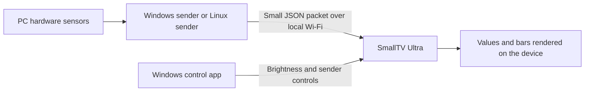

# GeekMagic SmallTV Sensor Mod

[](LICENSE)


Turn a **GeekMagic SmallTV Ultra** into a live PC hardware monitor, with a native display renderer and a Windows desktop control app.

Your computer reads its hardware sensors and sends a small JSON packet over your local network. The clock draws the values and bars itself. **No screenshots, JPEG uploads, cloud account, or Home Assistant installation are needed.** Live metrics stay in the device's RAM.

> **Current version: 1.5.** This replaces the clock's original firmware. It is an independent community project for the ESP8266 Ultra, not the Pro/ESP32 models. Source builds are provided; private Wi-Fi credentials are not bundled in a public firmware download.

## Contents

- [Features](#features)
- [Compatibility](#compatibility)
- [How it works](#how-it-works)
- [Quick start](#quick-start)
- [Windows setup](#windows)
- [Customize the dashboard](#customize-the-dashboard)
- [Linux / CachyOS](#linux--cachyos)
- [Configuration and API](#configuration-and-api)
- [Troubleshooting](#troubleshooting)
- [Project layout](#project-layout)
- [Credits and license](#credits-and-license)

## Features

The default dashboard is arranged like this. Each panel can be replaced with another available measurement:

| CASE / SYSTEM | CPU |
|---|---|
| Motherboard system temperature in °C | CPU temperature in °C and CPU load bar |
| **RAM** | **GPU** |
| Memory usage in %, used/total GB and usage bar | GPU temperature in °C and GPU load bar |

- Large numbers, with prominent **°C** and **%** units at the lower right.
- A 240 × 240 native dashboard with a two-by-two layout.
- Buffered, partial redraws: only changed values and bar segments are updated.
- Two-second updates by default; missing sensors show `--`.
- A waiting indicator appears after 15 seconds without fresh data.
- Brightness, rotation and color inversion controls, saved on the device.
- Password-protected web settings and Wi-Fi firmware updates.
- Windows controls for live readings, brightness, update interval and pausing/resuming the sender.
- Choose 1–4 display panels; choose side-by-side or stacked panels when using two.
- Click a panel to select CPU/GPU temperature or usage, RAM percentage/used/total, or system temperature.
- Preview the layout in the desktop app, then apply it. The layout is saved on the display.
- A Python 3 Linux sender for AMD CPU/GPU hardware; no third-party Python packages.

**CASE is the motherboard's system sensor, not a separate air-temperature probe.** Its bar uses a 0–100 °C scale. CPU/GPU bars show load; the RAM bar shows memory usage.

## Compatibility

This project targets the **SmallTV Ultra with an ESP8266 / ESP-12F, 4 MB flash and ST7789 240 × 240 display**. SmallTV Pro and ESP32 variants require different firmware and pin maps.

The stock **Ultra-V9.0.41 → small loader → native monitor** Wi-Fi migration has been completed on a real device without opening its case. The Windows sender has been used with a Ryzen 5 5600, Radeon RX 6600 and Gigabyte B550 GAMING X V2. Other sensors depend on LibreHardwareMonitor support. The Linux sender is provided, but still needs hardware validation under CachyOS.

| Component | Status |
|---|---|
| ESP8266 SmallTV Ultra / ST7789 | Tested on a physical device |
| Stock Ultra-V9.0.41 Wi-Fi migration | Completed using the two-stage loader |
| Windows sender and desktop controls | Built and exercised with live sensor data |
| Custom layouts and metric selection | Tested on the display and through the desktop app |
| Linux / CachyOS sender | Source included; hardware validation pending |
| SmallTV Pro / ESP32 / unverified clones | Not supported by this firmware build |

## How it works



Sensor updates do not write image files or repeatedly write the device's flash. Saving display or Wi-Fi settings is a separate, occasional flash write. Closing the desktop control window leaves the background sender running.

## Quick start

1. Install Git, Python 3 and the .NET 10 SDK for Windows builds. Clone the project:

   ```sh
   git clone https://github.com/MrCurebal/geekmagic-smalltv-sensor-mod.git
   cd geekmagic-smalltv-sensor-mod
   ```

2. Install PlatformIO:

   ```sh
   python -m pip install platformio
   ```

3. Run `python tools/configure.py`. It prompts for your Wi-Fi name/password, generates a random device key, and writes ignored local configuration files. No credentials are printed.
4. Build the device firmware:

   ```sh
   python -m platformio run -d firmware -e loader -e monitor
   ```

5. Follow [the Wi-Fi installation guide](docs/INSTALLATION.md). Read the recovery limitations before replacing the stock firmware.
6. Build the Windows applications, or use the Linux sender below.

### Windows

```powershell
dotnet publish clients/windows/sender -c Release -o dist/windows
dotnet publish clients/windows/control -c Release -o dist/windows
```

Install **PawnIO** through the official [LibreHardwareMonitor project](https://github.com/LibreHardwareMonitor/LibreHardwareMonitor) if needed for CPU and motherboard sensor access. Run `clients/windows/InstallStartup.ps1` from an elevated PowerShell session. It starts the sender and creates a logon task with a 15-second delay. Then open `dist/windows/GeekMagicControl.exe`.

Keep `dist/windows` in its installed location. The control window runs normally; the background task supplies the sensor privileges. Use **Apply to display** to save brightness, address, interval and layout changes. Display address and API key must match the device's configuration.

### Customize the dashboard

Use **Panels** to choose one, two, three or four sections. Two sections can be **Side by side** or **Stacked**. Three sections use two panels above a wide bottom panel; four use a 2 × 2 grid. Click a panel's heading, value or background to open the metric list. **Apply to display** saves the layout to the clock and your local configuration. Ordinary metric updates continue to use RAM only. Layout settings require firmware 1.5 or newer.

### Linux / CachyOS

```sh
python3 clients/linux/monitor.py
```

The sender reads `/proc` and `/sys/class/hwmon`. CPU temperatures use `k10temp`, `zenpower` or `coretemp`; AMD GPU readings use `amdgpu`. The system sensor is supported when the board's `it8689` hwmon driver is available. Missing readings are sent as `null`. Stop with Ctrl+C. Automatic Linux startup is not configured by this repository.

## Configuration and API

See [config.example.json](config.example.json) and [the API reference](docs/API.md).

The firmware's web login is `admin`; the password is your generated `ApiKey`. That same key protects metric updates and the fallback `PC-Info-Recovery` access point. The fallback network appears if the device cannot join your Wi-Fi. The firmware uses local HTTP, so use it on a trusted home network.

**Never publish `private_config.h`, actual `config.json` files, or firmware binaries built with your credentials.** These files are ignored by Git. The repository intentionally contains source and configuration examples, rather than a universal firmware binary with shared credentials.

## Troubleshooting

| Symptom | What to check |
|---|---|
| The stock updater reports **Not Enough Space** | Upload the small loader first, then the monitor image through the loader. See [installation](docs/INSTALLATION.md). |
| The screen is dark after the first upload | The temporary loader does not draw a dashboard. Look for its `SmallTV-Loader` Wi-Fi network and open its update page. |
| Desktop app says **Display unavailable** | Check the device address, shared API key and local network. DHCP may change the address after flashing. |
| CPU or system temperature is `--` | Install the official sensor driver prerequisite and run the Windows sender with administrator access. Unsupported sensors remain unavailable. |
| **WAITING FOR DATA** appears | Start the PC sender and check `monitor.log`. The caption appears when updates are more than 15 seconds old. |
| Panel customization returns a firmware error | The display needs firmware 1.5 or newer for `/api/layout`. |
| The image is upside down | Change rotation in the device's web settings. The shipped orientation is 180°. |

The display itself does not measure PC temperatures. A Windows or Linux sender must remain running while you want live readings.

## Project layout

```text
firmware/                 Native display firmware and the small OTA loader
clients/windows/sender/   LibreHardwareMonitor-based background sender
clients/windows/control/ Windows desktop control app
clients/linux/            Python 3 Linux sender
tools/configure.py        Creates private local configuration
docs/                    Installation and HTTP API documentation
```

## Credits and license

Independent community project; not affiliated with or endorsed by GeekMagic.

The small OTA loader comes from [giovi321/smalltv-mod](https://github.com/giovi321/smalltv-mod), with its original attribution retained. Windows sensor readings use [LibreHardwareMonitor](https://github.com/LibreHardwareMonitor/LibreHardwareMonitor). The firmware uses the ESP8266 Arduino core, Adafruit graphics/display libraries and ArduinoJson. See [THIRD_PARTY.md](THIRD_PARTY.md).

New project code is available under the MIT license. Third-party components retain their own licenses.
